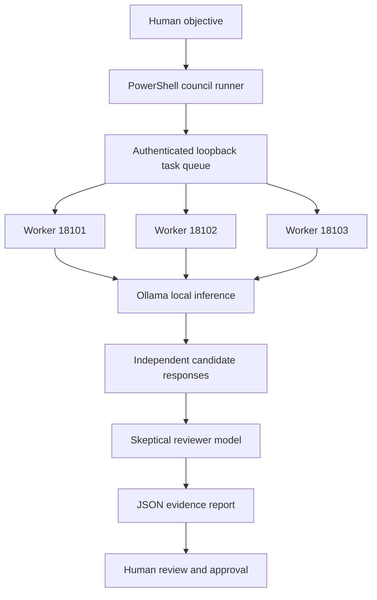

# HeavenzFire Multi-Model Council and Local Mesh Pipeline

**Status:** Implemented and smoke-tested on the Windows 11 host on 2026-10-19. The code and report paths below are local to the operator's machine; this document does not claim a public deployment.

## Purpose

Connect multiple local language models through a bounded, authenticated task queue so they can independently propose engineering solutions, followed by a skeptical review pass. Keep orchestration private to the local host, record task outcomes, and require a human to approve any implementation.

## Pipeline

The workers currently support two bounded task types:

- `hash_task`: deterministic SHA-256 workload used for acceptance testing.
- `model_task`: local Ollama inference using an explicit model allowlist, a bounded prompt, and a bounded output token count.

The council runner invokes candidate models sequentially to limit resource pressure, then asks a reviewer model to identify agreement, disagreement, unsupported claims, and a measurable acceptance test. It does not run shell commands, edit source code, place bets, or deploy changes.

## Current local model roster

- `qwen2.5:0.5b`
- `llama3.2:1b`
- `heavenzfire-runtime:latest`
- `heavenzfire:latest`

The default council uses Qwen, Llama 3.2, and HeavenzFire Runtime for candidate generation, then Qwen for review. Model agreement is not proof; responses must be checked against independent evidence and tests.

## Verification observed

- Unified Field launch: all 11 registered core services/workers returned healthy in the launch report.
- Authenticated mesh acceptance: `hash_task` completed with the expected SHA-256 output.
- Queued model inference: `model_task` completed through a mesh worker using Qwen.
- Multi-model council: three candidate tasks completed, one per distinct worker; the review task also completed. A JSON report was written locally.
- Agent health discovery: the tool call and structured health fields passed validation. A grounding guard was added to replace a model-generated “model missing” claim when the structured health result explicitly says the requested model is installed.
- Python worker tests: 5/5 passed, including deterministic hashing, invalid task limits, model allowlisting, and a live local inference test.
- Integration registry: updated to include all three workers and the council workflow. JSON parsing and live hub discovery passed.

These are local acceptance results, not a claim of production readiness or independent third-party audit.

## Security and privacy boundaries

- Coordinator, model runtime, gateway, and worker health endpoints bind to loopback on the Windows host.
- Queue operations require a bearer token protected at rest using Windows DPAPI for the current user.
- Workers accept only the declared task types and allowlisted model names; no arbitrary shell or tool execution is exposed through `model_task`.
- The council report records model, worker, task status, and the final review. The local report directory is not automatically uploaded to GitHub.
- No mobile bridge or LAN exposure is implied. Those remain separate integration tasks requiring explicit verification.
- “Quantum threading” here means asynchronous classical task routing and parallel worker capacity. No quantum hardware, entanglement, or quantum speedup is claimed.
- “Genetic” orchestration is a planned evolutionary improvement loop: propose, test, compare evidence, keep or reject a change, and retain a regression test. No autonomous self-modification is enabled by this council.

## Local entry points

- `HeavenzFire/Invoke-HeavenzFireCouncil.ps1`: run a multi-model council against a bounded objective.
- `heavenzfire-capsule-v02/mesh-v0.1/worker.py`: authenticated queue worker with hash and model task support.
- `heavenzfire-capsule-v02/mesh-v0.1/test_model_pipeline.py`: worker regression and local-inference tests.
- `HeavenzFire/Enter-UnifiedField.ps1`: starts/verifies the service fabric and runs mesh, model, orchestrator, and agent smoke tests.
- `heavenzfire-capsule-v02/ecosystem-integration/service-catalog.json`: service contracts and integration edges.
- `heavenzfire-capsule-v02/ecosystem-integration/ecosystem-registry.json`: local service discovery, including the three mesh workers.

## Next engineering milestones

1. Add a bounded, typed tool-dispatch contract shared by local and remote model adapters.
2. Add task cancellation, idempotency keys, explicit deadlines, and per-model concurrency budgets.
3. Add independent verification tasks and regression gates before a proposed code change can be applied.
4. Add connector adapters for GitHub and research/browser tools without moving credentials into model prompts.
5. Build a privacy-preserving anti-manipulation analysis pipeline for user-provided screenshots or public pages, with evidence citations, false-positive review, and human approval.
6. Expose a mobile control interface only after authentication, device identity, network boundary, and recovery behavior are tested.
